# First State Lens — image collection redesign

Unretouched native iPhone 17 Pro Simulator captures from October 24, 2026. Library/course comparisons use the same isolated, empty test profile; Today compares the ordinary learner before and after without resetting progress.

## Library

| Before | After |
| --- | --- |
| 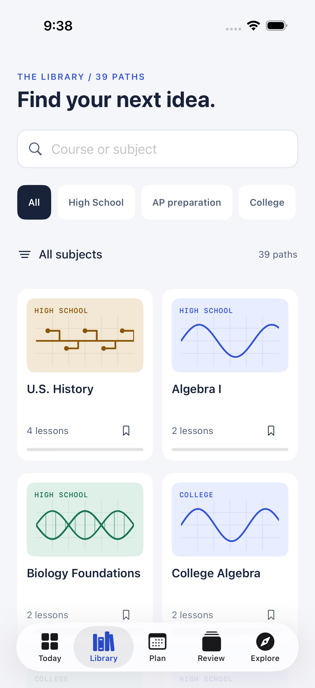 | 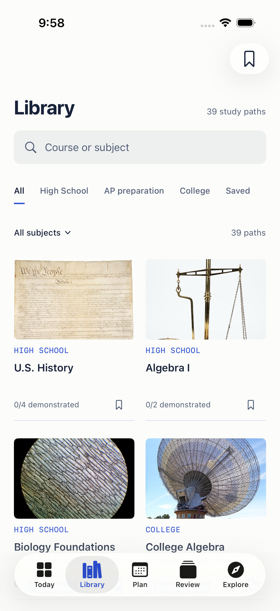 |

The revised grid separates image, level, title, and recorded progress. Search, subject/level filters, and save controls remain actionable. The covers are bundled locally, not hotlinked. Four covers are visible at once at ordinary text sizes, with additional courses reached by scrolling.

## Today

| Before | After |
| --- | --- |
| 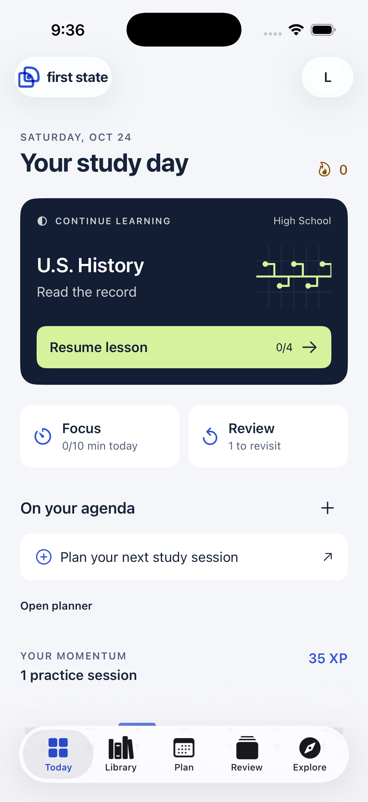 | 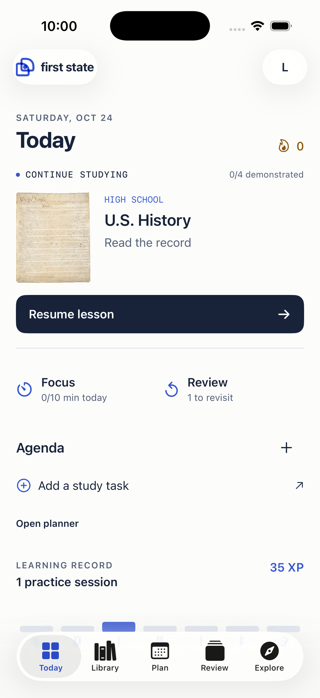 |

The existing 35 XP and one practice session remain intact. The large dark poster and decorative diagram are replaced by the actual course image, next lesson, and a single resume action. Focus, review, and agenda remain close at hand. Empty work is not populated with fake tasks.

## Course detail

| Before | After |
| --- | --- |
| 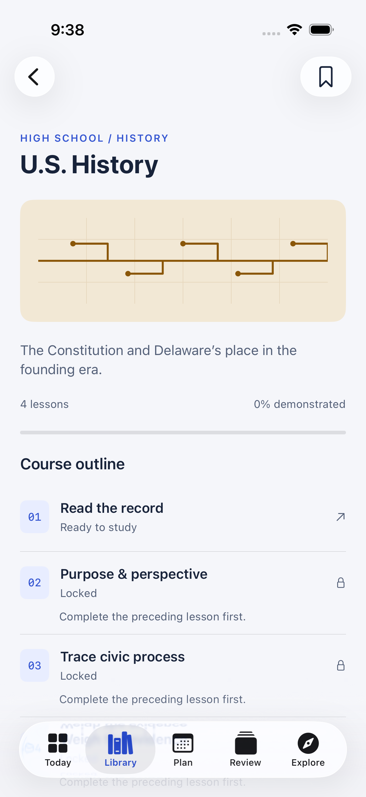 | 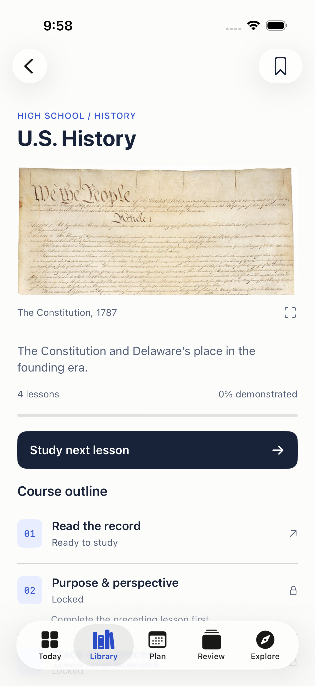 |

The image's original record opens without losing syllabus context. Published lesson scope and demonstrated progress remain distinct.

## Inspect the source

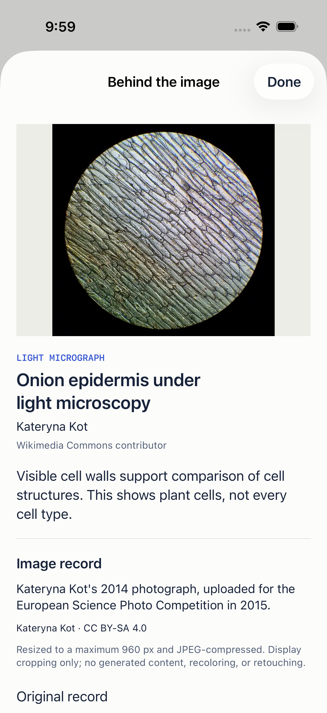

This is a light micrograph by Kateryna Kot, not generated illustration. Other media types are labeled explicitly. The app preserves licensing, credit, source links, modifications, and the limits of the image's relationship to the lesson. Credits can be searched by image, course, or creator.

## Computing collection

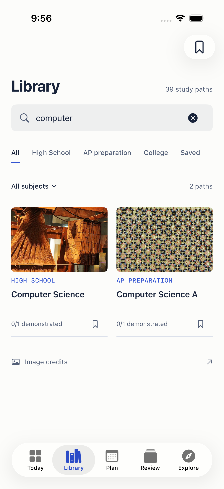

## Academic profile

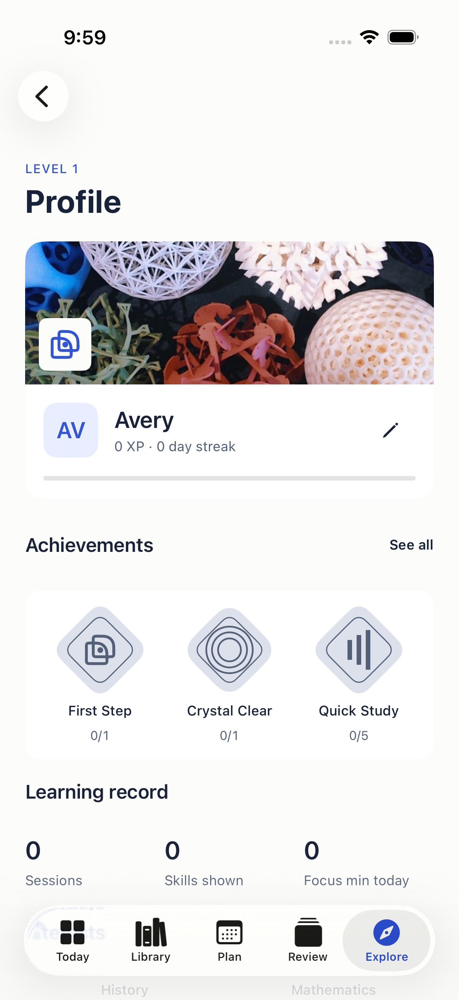

Subject image selection, interests, and earned-achievement featuring remain functional. This empty test profile displays locked achievements honestly; it does not invent completed work.

## Appearance and text scaling

| Dark appearance | Accessibility-sized text |
| --- | --- |
| 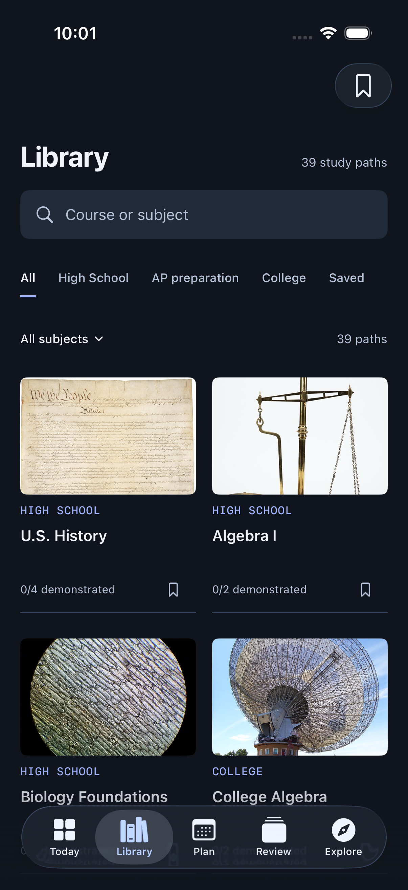 | 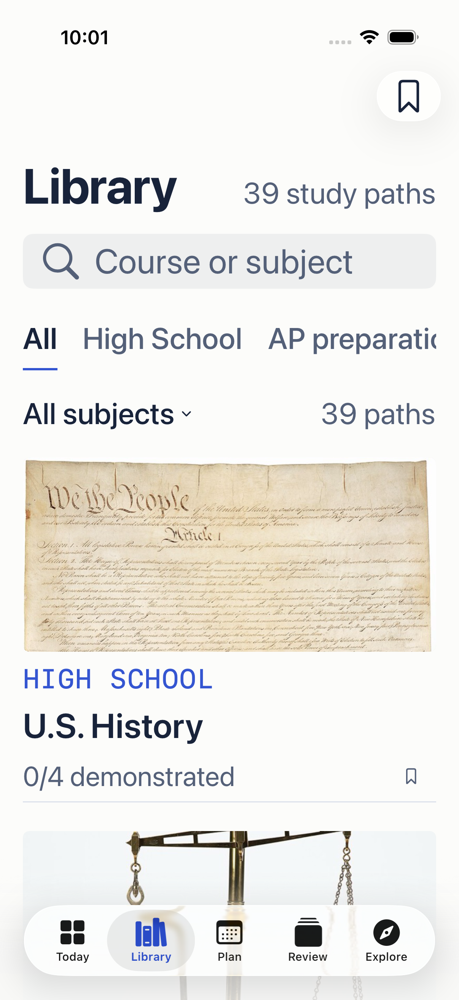 |

The larger-text layout intentionally becomes a single column. The level selector scrolls horizontally rather than truncating its controls to fit.

See [design decisions](../../IMAGE_COLLECTION_REDESIGN.md), [asset credits](../../COURSE_IMAGE_CREDITS.md), and [verification/remaining gates](../../../STATUS.md).
