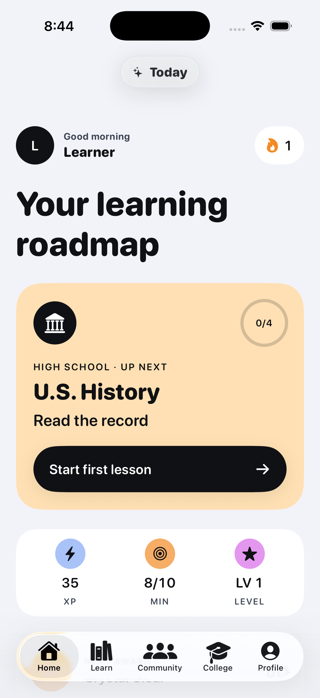
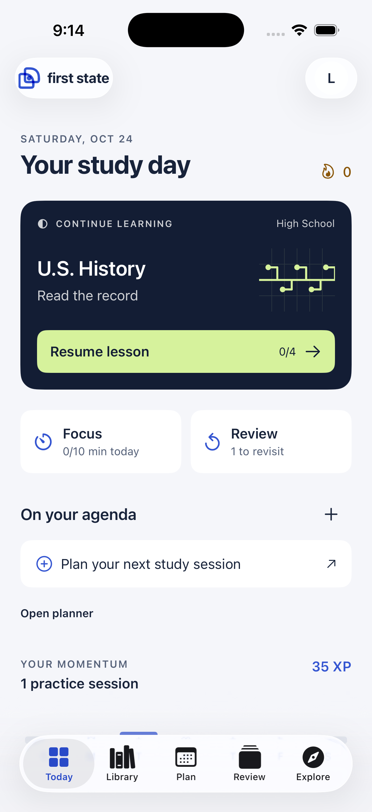
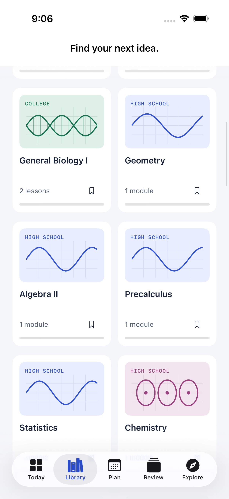
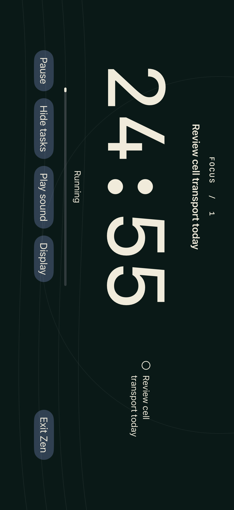

# Visual review

Latest: [the image collection redesign and before/after review](Collection/README.md).

The screenshots below record the earlier workspace pass, before course photography was introduced.

Native Simulator screenshots from the October 24 workspace redesign. Images are unretouched captures.

| Original Today | Redesigned Today |
| --- | --- |
|  |  |

The same ordinary local profile retains its 35 XP. The redesign replaces the oversized title and course panel with a compact resume action, Focus/Review entry points, an agenda, and an activity record. The older estimated lesson-minute metric has been replaced by actual recorded Focus time.

## Compact course header

The heading fades and scales as the page scrolls; a native navigation title becomes visible. The verification asserts the title is both present and hittable, rather than relying only on an accessibility label.

## Landscape Zen

This capture uses an isolated UI-test account and a test-created task. The actual running session is shared with Focus. Upcoming tasks can be hidden; leaving Zen preserves the timer.

Design references and decisions: [Workspace redesign](../WORKSPACE_REDESIGN.md). Verification details and remaining gates: [Status](../../STATUS.md).
